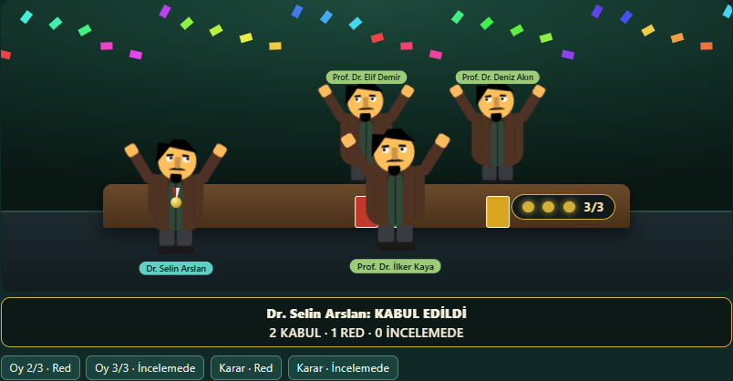
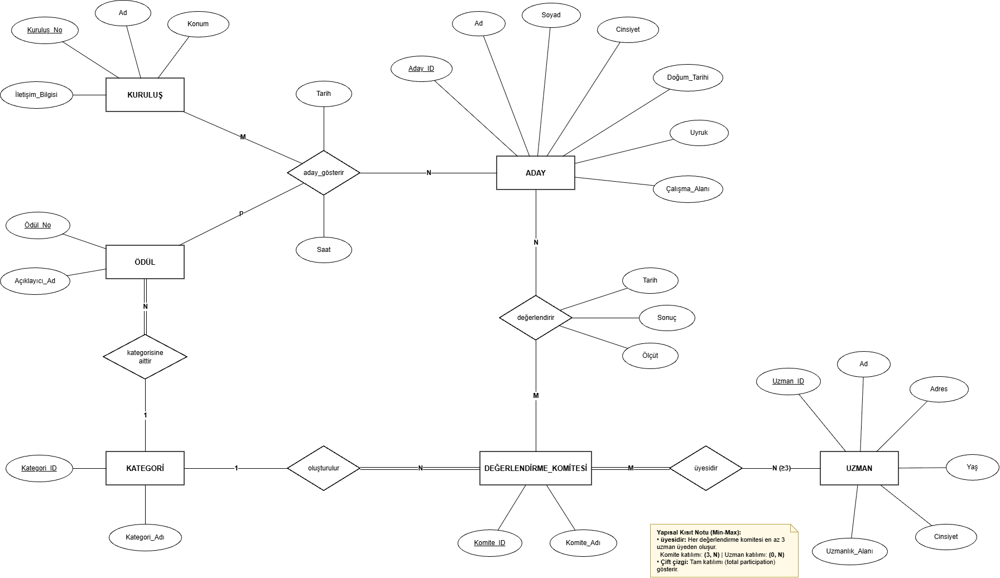

# Nobel Ödülü Değerlendirme Sistemi

**Veri Tabanı Yönetim Sistemleri dersi projesi**

Bu proje, bir Nobel Ödülü adaylığının kuruluş tarafından önerilmesinden uzmanların oylarıyla komite kararının kesinleşmesine kadar olan süreci modelleyen bir eğitim uygulamasıdır. PostgreSQL şeması, rol bazlı portallar ve canlı ER diyagramı aynı akış üzerinde ilişkisel modelleme, veri bütünlüğü ve işlem yönetimini gösterir.

Veritabanı PostgreSQL 16 üzerinde geliştirildi. Spring Boot 3.5 ve Angular 21 uygulaması IntelliJ IDEA üzerinden geliştirildi. Flyway şemayı ve başlangıç kayıtlarını kurar.

## Öğretim elemanı için teslim

| Dosya | İçerik |
| --- | --- |
| [nobel-postgresql.sql](docs/teslim/nobel-postgresql.sql) | Boş bir PostgreSQL veritabanına yüklenebilen ders şeması, ilişkiler, tetikleyiciler ve örnek kayıtlar |
| [nobel-access.accdb](docs/teslim/nobel-access.accdb) | Microsoft Access'te doğrudan açılabilen, aynı 10 tablonun örnek kayıtları ve ilişkileri |
| [ER diyagramı](docs/NOBELfinal.drawio.png) | Adaylık, ödül, kategori, komite ve uzman ilişkilerinin kavramsal gösterimi |

### Yalnızca veritabanını açma

Docker çalışırken proje kökünde bir PostgreSQL servisi başlatın ve teslim dosyasını yükleyin. `nobel-vtys-db` projesi ilk kullanımında yeni bir veritabanı birimi oluşturur. SQL dosyası boş şemaya bir kez yüklenir.

```bash
docker compose -p nobel-vtys-db up -d --wait postgres
docker compose -p nobel-vtys-db cp docs/teslim/nobel-postgresql.sql postgres:/tmp/nobel-postgresql.sql
docker compose -p nobel-vtys-db exec -T postgres psql -U nobel_username -d nobel_db -v ON_ERROR_STOP=1 -1 -f /tmp/nobel-postgresql.sql
docker compose -p nobel-vtys-db port postgres 5432
```

| PostgreSQL bağlantısı | Değer |
| --- | --- |
| Host | `127.0.0.1` |
| Port | Son komutun çıktısındaki port numarası |
| Veritabanı | `nobel_db` |
| Kullanıcı adı | `nobel_username` |
| Yerel demo şifresi | `nobel_password` |
| Şema | `public` |

IntelliJ IDEA'da **Database → + → Data Source → PostgreSQL** yolunu açın ve bu bilgileri girin. Gerekirse JDBC sürücüsünü indirin, ardından **Test Connection** ile bağlantıyı doğrulayın. `public` şemasında tablolara çift tıklayabilir veya **Diagrams → Show Diagram** ile ilişkileri açabilirsiniz. Ayrıntılar ve örnek sorgular [veritabanı erişim rehberinde](docs/veritabani-erisim-rehberi.md).

Grafik istemci kurmadan SQL konsolunu açmak için `docker compose -p nobel-vtys-db exec postgres psql -U nobel_username -d nobel_db` komutunu kullanın. Docker dışında mevcut bir PostgreSQL kurulumunda ise aynı dosyayı boş bir veritabanına `psql -U nobel_username -d nobel_db -v ON_ERROR_STOP=1 -1 -f docs/teslim/nobel-postgresql.sql` ile yükleyebilirsiniz.

### Tüm uygulamayı açma

Docker Desktop veya Docker Engine ve Docker Compose açıkken teslim edilen proje klasöründe çalıştırın.

```bash
docker compose -p nobel-vtys-sunum up -d --build --wait
docker compose -p nobel-vtys-sunum ps
```

| Sayfa | Adres |
| --- | --- |
| Giriş ve demo hesapları | [localhost:4200/login](http://localhost:4200/login) |
| Canlı ER diyagramı ve karakter sahnesi | [localhost:4200/live-stage](http://localhost:4200/live-stage) |
| Dinamik senaryolar | [localhost:4200/dinamik-senaryolar](http://localhost:4200/dinamik-senaryolar) |

İlk kurulumda imajlar indirilir ve uygulama derlenir. Java, Maven ve Node.js konteynerlerde yer alır. Flyway uygulamanın ayrı veritabanına şemayı, örnek kayıtları ve portalların ihtiyaç duyduğu tabloları yükler. Giriş sayfasındaki demo profilini seçerek ilgili portalı açabilirsiniz. Demo girişi için siteyi `localhost` ile açın.

Uygulamanın veritabanına IntelliJ ile bağlanmak için portu `docker compose -p nobel-vtys-sunum port postgres 5432` ile alın ve yukarıdaki bağlantı bilgilerini kullanın. Servisleri `docker compose -p nobel-vtys-sunum stop` ile durdurabilirsiniz. Veriler yeniden başlatmada korunur.

### Microsoft Access'te açma

[nobel-access.accdb](docs/teslim/nobel-access.accdb) dosyasını Microsoft Access'te açın. Sol bölmedeki **Tablolar** listesinden kayıtları, **Veritabanı Araçları → İlişkiler → Tüm İlişkiler** bölümünden birincil ve yabancı anahtar bağlantılarını inceleyebilirsiniz. Dosya yerel bir örnek veri kopyasıdır ve kendi başına açılır. PostgreSQL'e özgü tetikleyiciler, üretilen sütun hesabı ve uygulamanın işlem kuralları PostgreSQL kurulumunda gösterilir. [Microsoft Access İlişkiler penceresi](https://support.microsoft.com/en-us/access/what-is-the-relationships-window)



## Neler yapılabilir?

| Rol | İşlemler |
| --- | --- |
| **Yönetici** | Kategorileri, ödülleri, adayları, kuruluşları, uzmanları ve komiteleri yönetir. Aday portalının gizlilik ayarını belirler. |
| **Kuruluş** | Kayıtlı bir kişiyi seçerek veya yeni bir aday oluşturarak ödül için aday gösterir. Kendi adaylıklarını takip eder. |
| **Uzman** | Üyesi olduğu komitede, komitenin kategorisindeki adaylar için ölçüt seçip oy verir. Komitedeki oyları ve kararı görür. |
| **Aday** | Kendi adaylıklarını, değerlendirme aşamalarını ve gizlilik ayarının izin verdiği sonuçları görür. |

- **Canlı Sahne** uygulama işlemlerini Server-Sent Events (SSE) üzerinden izler. İlgili ER düğümleri vurgulanır, işlem özeti görünür ve varsa karakter animasyonu oynar.
- **Dinamik Senaryolar** fizik, tıp ve kimya için örnek adaylıklar oynatır. Örneğin CERN bir adayı gösterir, üç uzman sırayla oy verir ve komite sonucu açıklanır. Her çalıştırmada oylar yeniden üretilir. Örnek akışlar veritabanına kayıt yazmadan tarayıcıda çalışır.

## ER modeli, tablolar ve örnek kayıtlar



| Tablo | Görevi ve ilk kurulumdaki örnek kayıtlar | Satır |
| --- | --- | ---: |
| `kategori` | Fizik, Kimya, Tıp, Edebiyat, Barış ve Ekonomi Bilimleri | 6 |
| `odul` | Kategoriye bağlı ödüller. Örnek olarak Nobel Fizik Ödülü. | 9 |
| `kurulus` | Aday gösteren kurumlar. CERN, Kuzey Sağlık Enstitüsü ve Uluslararası Kimya Akademisi dâhil. | 6 |
| `aday` | Adayın adı, doğum tarihi, uyruğu ve çalışma alanı. Selin Arslan, Ece Aydın ve Arda Yalçın dâhil. | 7 |
| `degerlendirme_komitesi` | Fizik, Tıp, Barış ve Kimya kategorilerinin komiteleri | 4 |
| `uzman` | Uzman profilleri. Prof. Leyla Aksoy, Prof. Jonas Berg ve Prof. Nil Aksoy dâhil. | 12 |
| `komite_uyesi` | Komite ve uzman arasındaki üyelik. Örnek kurulumda her komitenin üç üyesi var. | 12 |
| `aday_gosterme` | Kuruluş, aday ve ödülü adaylık tarihi ve saatiyle ilişkilendirir. | 6 |
| `uzman_oyu` | Komite üyesinin adaya verdiği oy, ölçüt ve oy zamanı | 9 |
| `degerlendirme` | Üç ön değerlendirme ve üç kesinleşmiş komite kararı | 6 |

PostgreSQL teslim dosyası ve Access kopyası bu 10 ders tablosunu içerir. Tam uygulama ayrıca `kullanici`, `sistem_ayari` ve `flyway_schema_history` tablolarını kullanır.

| Kategori | Kuruluş | Aday | PostgreSQL ve Access'teki örnek karar |
| --- | --- | --- | --- |
| Fizik | CERN | Selin Arslan | `KABUL` · 2 kabul, 1 ret |
| Tıp | Kuzey Sağlık Enstitüsü | Ece Aydın | `RED` · 1 kabul, 2 ret |
| Kimya | Uluslararası Kimya Akademisi | Arda Yalçın | `KABUL` · 3 kabul |

Bu kayıtlar ders sunumu için hazırlanmıştır. **Dinamik Senaryolar** sekmesi aynı örnekleri tarayıcıda oynatır ve her oynatmada yeni oylar üretir. Uygulama portallarından yapılan işlemler PostgreSQL'e kaydedilir. Ödülün kabul edilmesi `degerlendirme.sonuc` alanında gösterilir.

- `aday_gosterme`, kuruluşu, adayı ve ödülü aynı adaylık kaydında ilişkilendirir. `komite_uyesi`, komitelerle uzmanlar arasındaki çoktan çoğa ilişkiyi kurar.
- PostgreSQL’in ertelenebilir kısıt tetikleyicileri, işlem tamamlanırken komitede **en az üç uzman** bulunmasını denetler.
- `uzman_oyu` tablosundaki yabancı anahtar, uzmanın ilgili komitenin üyesi olmasını sağlar. Benzersizlik kısıtı aynı uzmanın aynı komitede aynı adaya ikinci kez oy vermesini engeller.
- Komitenin tüm üyeleri oy verdiğinde karar otomatik kesinleşir. Varsayılan olarak en az üç oy varsa karar elle de kesinleştirilebilir. `degerlendirme` tablosundaki `kesinlesmis` alanı, ön değerlendirmeleri nihai kararlardan ayırır.
- Flyway `V1`–`V7` geçişleriyle şemayı ve başlangıç verilerini yönetir. `V7` sunum kayıtlarını ekler. Hibernate, Java varlıklarının şemayla uyumunu başlangıçta doğrular.

Güncel tablo ve kısıt tanımları [Flyway geçişlerinde](backend/src/main/resources/db/migration) yer alır. [IntelliJ veritabanı görünümü](docs/IntellijDatabase.png) de depoya eklenmiştir.

## Yerel geliştirme

`4200` doluysa `NOBEL_APP_PORT` değişkenini boş bir porta ayarlayın. Örneğin PowerShell’de aşağıdaki komutlarla [localhost:14200](http://localhost:14200) üzerinden açabilirsiniz.

```powershell
$env:NOBEL_APP_PORT = '14200'
docker compose -p nobel-vtys-sunum up -d --build --wait
```

Hazır imajları [Container images iş akışı](.github/workflows/container-images.yml) GitHub Container Registry’ye yayımlar. Teslim sürümünün imajları yayımlandığında `docker compose -p nobel-vtys-sunum up -d --wait` derleme olmadan başlayabilir. Başlangıç kayıtlarını `docker compose -p nobel-vtys-sunum logs -f backend` ile takip edebilirsiniz.

Önceden `nobel_user` ile açılmış bir Docker veritabanını aynı proje adıyla kullanmak için `NOBEL_DB_USERNAME=nobel_user` ayarını verin. Sunum projesi yeni bir birimde varsayılan `nobel_username` hesabıyla kurulur.

### Java ve Angular’ı yerelde geliştirme

Bu yöntem Java 21, Maven 3.9.x, Node.js 24 ve npm ile çalışır. Proje kökünde `docker compose up -d postgres` çalıştırın. `docker compose port postgres 5432` çıktısındaki portu kullanarak API terminalinde `DB_URL` değişkenini ayarlayın. Örneğin port `55443` ise PowerShell’de `$env:DB_URL = 'jdbc:postgresql://127.0.0.1:55443/nobel_db'` çalıştırın.

```bash
cd backend
mvn spring-boot:run "-Dspring-boot.run.arguments=--server.address=127.0.0.1 --nobel.security.local-demo-login=true"
```

Proje kökünden ayrı bir terminal açın.

```bash
cd frontend
npm ci
npm start
```

Bu kurulumda arayüz `http://localhost:4200`, API `http://localhost:8080` adresinden çalışır.

## Dersi sunarken

1. **Canlı Sahne** sayfasını bir sekmede açık bırakın.
2. Başka bir sekmede CERN demo profiliyle giriş yapıp Nobel Fizik Ödülü için yeni bir aday gösterin. Canlı sahnede adaylık olayını ve ER vurgusunu izleyin.
3. Prof. Leyla Aksoy, Prof. Murat Erdem ve Dr. Elif Arslan profilleriyle sırayla giriş yapıp aynı adaya bir ölçüt seçerek oy verin. Her oy ER diyagramını tetikler. Üçüncü oyla birlikte nihai karar oluşur.
4. Aynı adayla giriş yapıp adaylığı ve değerlendirme sonucunu kontrol edin. Akışı örnek verilerle göstermek için **Dinamik Senaryolar** sekmesinden bir senaryo seçebilirsiniz.

## Testler

| Klasör | Komut | Kapsam |
| --- | --- | --- |
| `backend/` | `mvn verify` | Birim ve entegrasyon testleri. Testcontainers geçici bir PostgreSQL örneği başlatır. Docker açık olmalıdır. |
| `frontend/` | `npm test` | Angular ve Vitest testleri. |
| `frontend/` | `npm run build` | Üretim derlemesi `frontend/dist/` altında oluşturulur. |

## Depo yapısı

| Konum | İçerik |
| --- | --- |
| [`backend/`](backend) | REST API, güvenlik, iş kuralları, Flyway geçişleri ve PostgreSQL testleri |
| [`frontend/`](frontend) | Rol portalları, SVG ER diyagramı, canlı sahne ve dinamik senaryolar |
| [`docs/`](docs) | [Tasarım yol haritası](docs/YolHaritasi.md), [canlı olay akışı](docs/Faz-3A-Teslim-Notu.md) ve [karakter sahnesi](docs/Faz-3B-Teslim-Notu.md) teslim notları |
